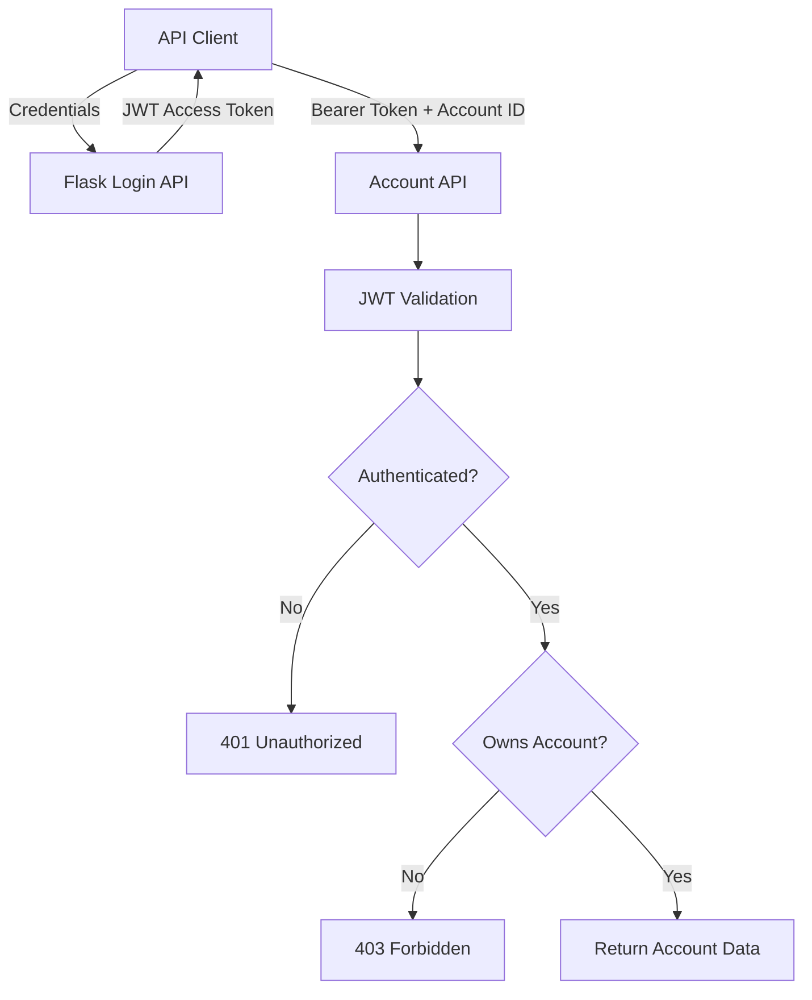

# Threat Modeling Lab — SecureBank API

A hands-on application security project demonstrating threat modeling,
STRIDE analysis, Broken Object Level Authorization (BOLA) remediation,
JWT authentication, security regression testing, and automated security
checks with GitHub Actions.

> **Lab only:** SecureBank is a deliberately simplified demonstration
> application. It is not intended for production use.

## Project Objectives

- Document system boundaries, components, and data flows.
- Identify threats using the STRIDE methodology.
- Maintain a threat register with remediation actions.
- Demonstrate and remediate a BOLA / IDOR-style authorization flaw.
- Implement JWT authentication and token validation controls.
- Verify security controls with automated regression tests.
- Integrate SAST, dependency, configuration, and secret scanning into CI.

## Architecture



See the architecture documentation for more detail:

- `architecture/system-context.md`
- `architecture/data-flow.md`
- `architecture/securebank-dfd.md`

## Threat Modeling

The project includes:

- STRIDE threat analysis
- Threat register with risk information
- Authentication threat analysis
- Security requirements and controls
- Remediation planning

Key files:

- `threat-model/stride-analysis.md`
- `threat-model/threat-register.csv`
- `threat-model/authentication-threats.md`
- `security-requirements/security-controls.md`
- `mitigations/remediation-plan.md`

## Security Finding: BOLA

Broken Object Level Authorization occurs when an API fails to verify
whether the authenticated user is authorized to access a requested object.

In this lab, users have separate account records. The account endpoint
must verify ownership rather than relying only on successful authentication.

**Remediation:** The API checks account ownership before returning account
data and denies cross-account access.

See `mitigations/bola-remediation.md` for the documented remediation.

## Security Controls Demonstrated

- JWT signature verification
- Token expiration validation
- Issuer and audience validation
- Rejection of missing or tampered tokens
- Account-level authorization
- Rejection of invalid login attempts
- Automated security regression tests

## Technology Stack

| Area | Technology |
|---|---|
| Application | Python, Flask |
| Authentication | PyJWT, JWT |
| Testing | pytest |
| Threat modeling | STRIDE, data-flow diagrams |
| SAST | Semgrep |
| Dependency and configuration scanning | Trivy |
| Secret scanning | Gitleaks |
| CI/CD | GitHub Actions |
| Version control | Git, GitHub |

## Run Locally

### 1. Clone the repository

```bash
git clone https://github.com/nikhildudhuke123/threat-modeling-lab.git
cd threat-modeling-lab
```

### 2. Create and activate a virtual environment

```bash
python3 -m venv .venv
source .venv/bin/activate
```

### 3. Install dependencies

```bash
python -m pip install --upgrade pip
python -m pip install -r requirements.txt
```

### 4. Generate a lab JWT signing key

```bash
export JWT_SECRET="$(python -c 'import secrets; print(secrets.token_hex(32))')"
```

Generate a fresh key for each new shell session. This example is for
local testing only; production applications should use managed secret
storage and appropriate key rotation.

### 5. Run the security regression tests

```bash
pytest -v
```

The local regression suite contains 20 tests covering BOLA authorization,
JWT validation, password-hash storage, successful and failed login,
malformed login inputs and Authorization headers, unsupported HTTP methods,
and unknown-account handling.

### 6. Configure demo credentials and run the API

The app requires `JWT_SECRET`, `USER_A_PASSWORD_HASH`, and
`USER_B_PASSWORD_HASH`. Generate local demo password hashes without
storing plaintext passwords or hashes in the repository:

```bash
export USER_A_PASSWORD_HASH="$(python -c 'import getpass; from werkzeug.security import generate_password_hash; print(generate_password_hash(getpass.getpass("Password for user-a: ")))' )"
export USER_B_PASSWORD_HASH="$(python -c 'import getpass; from werkzeug.security import generate_password_hash; print(generate_password_hash(getpass.getpass("Password for user-b: ")))' )"
```

Enter a password when prompted for each user. `getpass` hides
password input in the terminal. These commands set environment variables
for the current shell; do not commit their values or share them.

Generate a JWT signing key for the current shell:

```bash
export JWT_SECRET="$(python -c 'import secrets; print(secrets.token_hex(32))')"
```

Start the local demo API:

```bash
python application/app.py
```

The API binds to `127.0.0.1`. These are local lab credentials, not
a production identity system. Do not commit generated hashes or secrets.

## Automated Security Checks

The GitHub Actions workflow is located at
`.github/workflows/security.yml`.

It runs four jobs on pushes and pull requests:

1. **Security Regression Tests** — runs pytest.
2. **Semgrep SAST** — scans the application and test code.
3. **Trivy Security Scan** — scans dependencies, configuration, and secrets.
4. **Gitleaks Secret Scan** — checks repository Git history for likely secrets.

Latest verified workflow run: all four jobs passed.

[View GitHub Actions](https://github.com/nikhildudhuke123/threat-modeling-lab/actions)

A passing scan only means that the configured checks completed without
reported findings. It does not prove the absence of all vulnerabilities.

## Current Limitations

- This is a small educational API, not a production banking service.
- Sample user credentials are currently hardcoded in the application.
- Login rate limiting and production-grade credential storage need further work.
- Production deployment, key management, monitoring, and broader test coverage
  are outside the current implementation.

## Future Improvements

- Replace hardcoded credentials with securely stored password hashes.
- Add login rate limiting and stronger authentication protections.
- Expand negative and edge-case authorization tests.
- Add API security tests and further threat-driven test cases.
- Pin dependencies and third-party CI actions more rigorously.
- Add container image scanning and infrastructure-as-code checks.

## Disclaimer

This repository is for educational and defensive security testing.
Use the techniques only in systems you own or are explicitly authorized
to assess.
