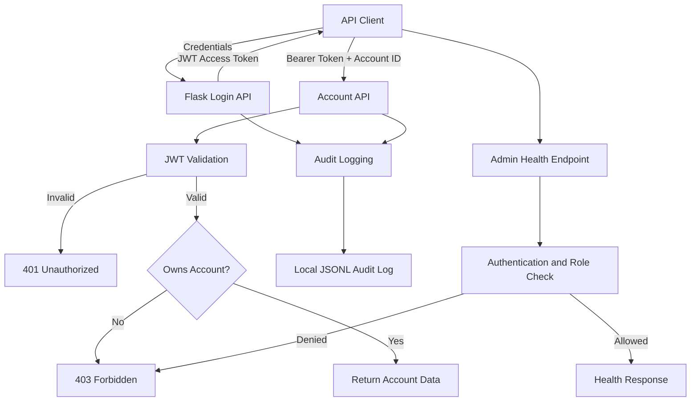

# Threat Modeling Lab — SecureBank API

A hands-on application security project demonstrating STRIDE threat modeling, BOLA/IDOR prevention, JWT authentication, role-based authorization, audit logging, API rate limiting, security regression testing, and automated security checks with GitHub Actions.

> **Lab only:** SecureBank is a deliberately simplified educational application, not a production banking service.

## Project Objectives

- Document system boundaries, components, and data flows.
- Identify threats using STRIDE and maintain a traceable threat register.
- Enforce account ownership checks to prevent BOLA/IDOR.
- Validate JWT signatures, expiry, issuer, and audience.
- Demonstrate role-based authorization for an example admin endpoint.
- Apply API rate limits and test HTTP 429 responses.
- Persist structured audit events and verify log hash-chain integrity.
- Run regression tests and security scanners locally and in CI.
- Document residual risks instead of claiming unverified mitigations.

## Architecture



Architecture documentation:

- `architecture/system-context.md`
- `architecture/data-flow.md`
- `architecture/securebank-dfd.md`

## Threat Modeling and Traceability

The repository contains:

- STRIDE analysis and a threat register.
- Authentication threat analysis.
- Security requirements and controls.
- Remediation planning.
- Threat-to-test traceability.

Key files:

- `threat-model/stride-analysis.md`
- `threat-model/threat-register.csv`
- `threat-model/threat-test-traceability.md`
- `threat-model/authentication-threats.md`
- `security-requirements/security-controls.md`
- `mitigations/remediation-plan.md`
- `mitigations/bola-remediation.md`
- `tests/security-test-plan.md`

Threat statuses reflect the evidence currently available. A passing regression test does not establish that every possible attack scenario is mitigated.

## Security Controls Demonstrated

### Authentication and authorization

- JWT signature, expiration, issuer, and audience validation.
- Rejection of missing, invalid, expired, and tampered tokens.
- Password-hash verification using Werkzeug.
- Account ownership enforcement to prevent cross-user access.
- `require_role("admin")` guard on the example admin health endpoint.
- HTTP 401 for unauthenticated requests and HTTP 403 for authorization denials.
- Unsupported account modification methods rejected with HTTP 405.

### Denial-of-service safeguards

Flask-Limiter applies per-client-IP limits:

| Endpoint | Limit |
|---|---:|
| `POST /api/login` | 5 requests per minute |
| `GET /api/accounts/<account_id>` | 30 requests per minute |
| `GET /api/admin/health` | 30 requests per minute |

Excess requests receive HTTP 429. The lab uses in-memory rate-limit storage; production multi-worker deployments need shared storage and additional capacity and abuse testing.

### Audit logging

- Structured JSON Lines audit events.
- Local persistent audit log.
- Restrictive file and directory permissions.
- Hash-chain verification and regression tests for tampering.
- Filtering of sensitive detail fields.

The local hash chain is not protection against a privileged attacker who can rewrite the entire log and recompute hashes. External log protection, independent integrity checkpoints, and retention controls remain unverified.

## Technology Stack

| Area | Technology |
|---|---|
| Application | Python, Flask |
| Authentication | PyJWT, JWT |
| Rate limiting | Flask-Limiter |
| Audit logging | Python logging, JSON Lines, SHA-256 hash chain |
| Testing | pytest |
| Threat modeling | STRIDE, data-flow diagrams |
| Static analysis | Semgrep |
| Dependency scanning | Trivy |
| Secret scanning | Gitleaks |
| CI | GitHub Actions |
| Version control | Git, GitHub |

## Run Locally

### 1. Clone the repository

```bash
git clone https://github.com/nikhildudhuke123/threat-modeling-lab.git
cd threat-modeling-lab
```

### 2. Create and activate a virtual environment

```bash
python3 -m venv .venv
source .venv/bin/activate
```

### 3. Install dependencies

```bash
python -m pip install --upgrade pip
python -m pip install -r requirements.txt
```

### 4. Configure the lab environment

Generate a temporary JWT signing key:

```bash
export JWT_SECRET="$(python -c 'import secrets; print(secrets.token_hex(32))')"
```

Generate demo password hashes without putting plaintext passwords or hashes in source code:

```bash
export USER_A_PASSWORD_HASH="$(python -c 'import getpass; from werkzeug.security import generate_password_hash; print(generate_password_hash(getpass.getpass("Password for user-a: ")))')"
export USER_B_PASSWORD_HASH="$(python -c 'import getpass; from werkzeug.security import generate_password_hash; print(generate_password_hash(getpass.getpass("Password for user-b: ")))')"
```

These variables apply to the current shell. Do not commit secrets or generated hashes.

### 5. Run the regression tests

The test module configures test-only password hashes. Set `JWT_SECRET` and run:

```bash
JWT_SECRET="$(python -c 'import secrets; print(secrets.token_hex(32))')" pytest -v
```

The latest locally verified suite contains **34 passing tests**. It covers authentication and JWT validation, account ownership, malformed login inputs, audit events and integrity, rate limiting, role authorization, and rejection of unsupported account modification methods.

### 6. Start the API

Configure `JWT_SECRET`, `USER_A_PASSWORD_HASH`, and `USER_B_PASSWORD_HASH` as described above, then run:

```bash
python application/app.py
```

The application binds to `127.0.0.1:5000`. Use only demo credentials in this lab.

## Automated Security Checks

The workflow is `.github/workflows/security.yml`.

It contains four jobs:

1. **Security Regression Tests** — runs pytest.
2. **Semgrep SAST** — scans application and test code.
3. **Trivy Security Scan** — scans dependencies, configuration, and secrets as configured by the workflow.
4. **Gitleaks Secret Scan** — checks Git history for likely secrets.

Run the local checks:

```bash
semgrep scan --config p/python --no-git-ignore --error application/ tests/
trivy fs --scanners vuln --detection-priority comprehensive .
gitleaks detect --source . --redact --verbose
```

Latest locally reported results: 35 tests passed, Semgrep reported zero findings across 151 rules, Trivy detected zero dependency vulnerabilities in `requirements.txt`, and Gitleaks reported no leaks. These results are scoped to the configured tools and scans; they do not prove the absence of all vulnerabilities.

[View GitHub Actions](https://github.com/nikhildudhuke123/threat-modeling-lab/actions)

## Current Limitations

- This is an educational API, not a production banking service.
- There is no persistent identity store or admin provisioning workflow.
- Role authorization is demonstrated on an example health endpoint; future privileged operations need equivalent enforcement and tests.
- Rate limiting uses in-memory storage and has not been validated against distributed abuse or broad resource exhaustion.
- Audit logs are stored locally; independent external protection, retention, and resistance to privileged rewriting remain unverified.
- No account mutation endpoint exists, so protection of future mutation operations still needs testing.
- Broader operational security, deployment hardening, monitoring, and resilience testing are outside the current scope.

## Future Improvements

- Add independent external audit-log storage and integrity checkpoints.
- Test rate limiting with shared storage and broader abuse scenarios.
- Add persistent identity and securely governed admin provisioning.
- Add mutation endpoints only with explicit authorization and integrity tests.
- Expand API security, operational resilience, and deployment testing.
- Pin CI actions and dependencies to stricter reproducible versions where appropriate.

## Disclaimer

This repository is for educational and defensive security testing. Use security testing techniques only on systems you own or are explicitly authorized to assess.
